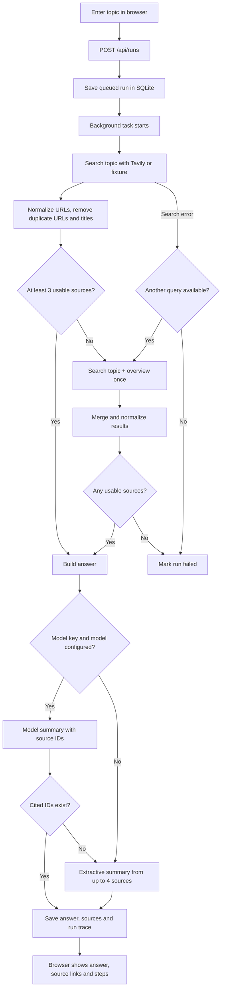

# Current workflow and result format

Each Tavily request asks for at most five basic search results. The agent currently uses at most two fixed queries; it does not ask a model to create the search plan. A second query runs only if the first leaves fewer than three usable sources. No date window or independent fact checking is implemented.

## Result fields

- `answer`: either a model-written brief with numbered citations, or an extractive list of up to four source snippets.
- `sources`: title, canonical URL, content snippet, Tavily score, domain and local citation ID.
- `summary_mode`: `model` or `extractive`.
- `coverage_warning`: true when fewer than three usable sources were found.
- `queries_used`: one or two.
- Run metadata: status, search attempts, step events and any error are stored in SQLite and exposed through `GET /api/runs/{id}`.

The browser displays this result. Live runs do not currently create a Markdown file; `examples/sample-brief.md` is generated separately from the synthetic fixture by `scripts/generate_example.py`.
