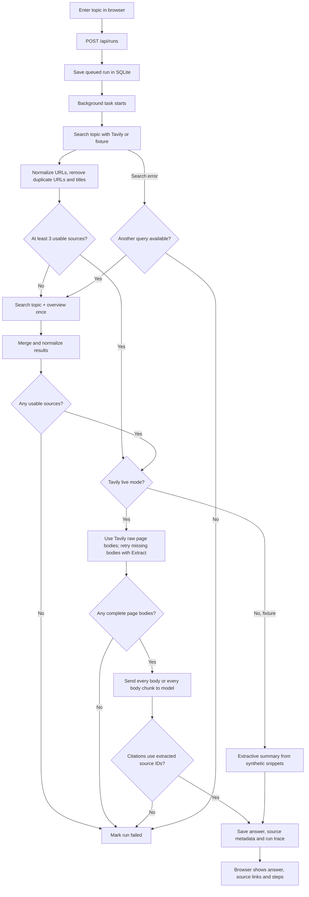

# Current workflow and result format

Each Tavily request asks for at most 20 basic search results with `include_raw_content=markdown`. Missing bodies are retried with the Tavily Extract API. The agent uses at most two fixed search queries; a second query runs only if the first leaves fewer than three usable search results. Deduplication and extraction failures may leave fewer than 20 complete pages.

Live runs may specify `time_range` (`day`, `week`, `month`, `year`) or custom `start_date`/`end_date` (`YYYY-MM-DD`), but not both. A selected window enables Tavily's `filter_by_published_date`, excluding pages with unknown publication dates. With no window, date filtering is disabled. Every search attempt records measured HTTP response latency and its fixed `basic` search depth; completed runs record total elapsed time. `GET /api/metrics` averages search latency across calls and report latency across completed runs in the latest 20 provider runs, with counts for context.

Every available complete page body is read by the model. Up to 100,000 characters of combined body text go directly to a final synthesis call. Larger inputs are split into consecutive 100,000-character chunks; each chunk is sent to the model, and the resulting notes feed a final cited synthesis. No body is cut at 800 characters or silently truncated. Runs above 5,000,000 total extracted characters fail with an explicit limit error. Long pages increase model calls, time and API usage. Full bodies are held during processing; the run record stores source URLs, search snippets and body lengths, not the full copyrighted page text. No date window or independent fact checking is implemented.

## Result fields

- `answer`: a model-written brief with numbered citations in live mode, or an extractive brief in offline fixture mode.
- `sources`: title, canonical URL, search snippet, Tavily score, domain, local citation ID, `body_chars` and `content_type`. A source with `content_type=search_snippet_only` was not sent to the live model.
- `summary_mode`: `model` or `extractive`.
- `searched_results`, `extracted_pages`, `extraction_failures`: counts and URLs that make missing bodies visible.
- `coverage_warning`: true when fewer than three usable full-page sources were found in live mode.
- `queries_used`: one or two.
- Run metadata: status, search attempts, step events and any error are stored in SQLite and exposed through `GET /api/runs/{id}`.

The browser displays this result. Live runs do not currently create a Markdown file; `examples/sample-brief.md` is generated separately from the synthetic fixture by `scripts/generate_example.py`.
